## 要求

Chapter 10 的 Linux 基础实验 实验四, shell 编程  

### 实验目的

1. 了解 shshell 的特点和主要种类
2. 掌握使用 Linux 系统实现 shell 脚本的建立和执行方式
3. 掌握 bash 基本语法
4. 学会编写 shell 脚本

### 实验内容

1. 使用 linux 系统查看 shell
2. 使用 linux 系统实现 shell 脚本的建立和执行
3. 历史命令和别名定义
4. shell 变量和位置参数\ 环境变量
5. bash 的特殊字符
6. 一般控制结构
7. 算术运算以及 bash 函数

### 主要实验步骤

1. 登录 linux, 查看系统默认安装的 shell; 查看当前登录用户默认 shell
2. 利用 vi 建立一个脚本文件, 其中包括 date\ cal\ pwd\ ls 等常用命令, 然后以不同的方式执行该脚本  
3. 运行 history 命令, 配置历史命令环境
4. 体会 bash 的命令补全功能
5. 用 alias 定义别名, 然后执行
6. 对下面的 shell 脚本进行编辑, 然后执行
    ```sh
    count = $#
    cmd = echo
    while [ $count -gt 0 ]
    do 
        cmd="$cmd \$$count"
        count=`expr $count-1`
    done
    eval $cmd
    ```
7. 编写一个求斐波那契数列前 10 项以及总和的 shell 然后执行
8. 按照习题 4.18 的要求编写脚本, 然后执行
9. 运行课本例 4.20 的程序. 若取消其中的 "eval", 则会出现什么情况? 

> 4.18  
> 设计一个程序 cuts, 由标准输入读取数据, 获取由第一个参数 n 和第二个参数 m 所限定范围的数据, n 和 m 都是整数, 即从输入的字符串中抽取第 n 个字符至第 m 个字符之间的所有字符 (包括这两个字符). 例如:  
> ```
> cuts 11 14  
> this is a test of cuts program (输入)  
> test                           (显示结果)  
> ```  
> .  

> 例 4.20  
> ```
> $ cat ex20
> ```
> 
> ```sh
> #!/bin/bash
> getc()
> {
>     stty raw
>     tmp=`dd bs=1 count=1 2>/dev/null`
>     eval $1='$tmp'
>     stty cooked
> }
> press_any_key()
> {
>     echo -n "Strike any key to continue ..."
>     getc anychar
> }
> 
> echo -n "Enter a character: "
> getc char
> echo
> echo "You entered $char "
> press_any_key char
> echo
> ```
> 
> ```
> $ ex20
> ```
> 
> ```
> Enter a character:A
> You entered A
> Strike any key to continue ... B
> ```

## 实验具体操作

### 登录 linux, 查看系统默认安装的 shell; 查看当前登录用户默认 shell

查看系统登记的 shell 使用命令  

```sh
cat /etc/shells
```

显示当前账号配置的默认 shell  

```sh
getent passwd "$(id -un)" | cut -d: -f7
```

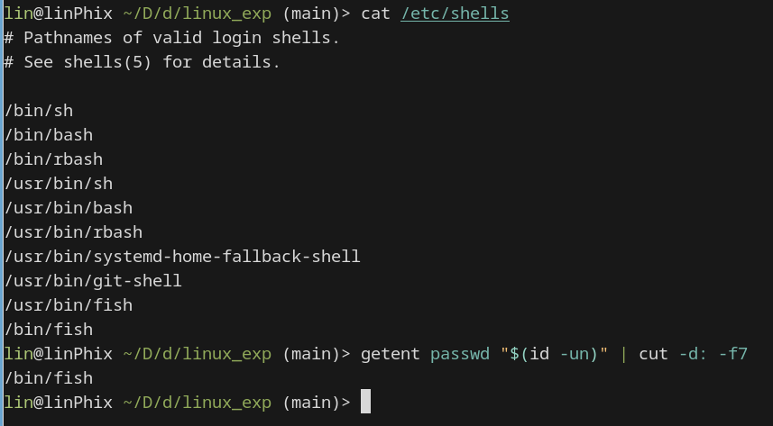

### 利用 vi 建立一个脚本文件, 其中包括 date\ cal\ pwd\ ls 等常用命令, 然后以不同的方式执行该脚本  

脚本文件  

```sh
date
cal
pwd
ls

```

执行方式  

```sh
bash ./exp-2-2.sh
chmod +x ./exp-2-2.sh && ./exp-2-2.sh
cat ./exp-2-2.sh | bash
```

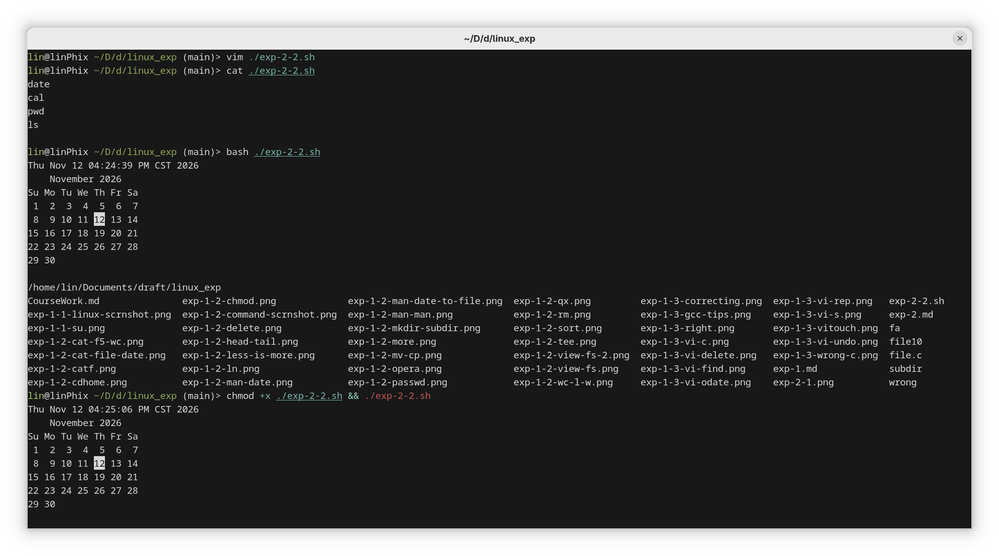  
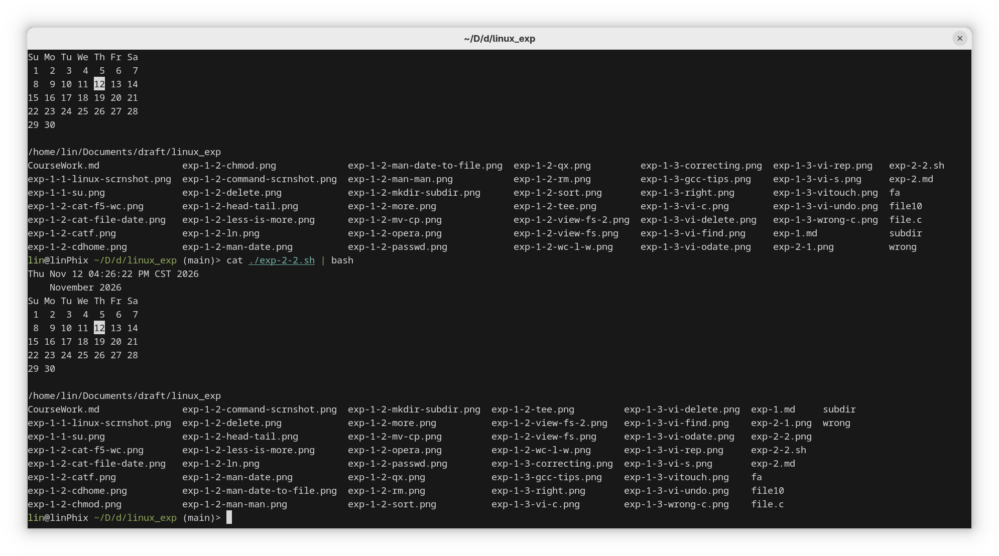

### 运行 history 命令, 配置历史命令环境

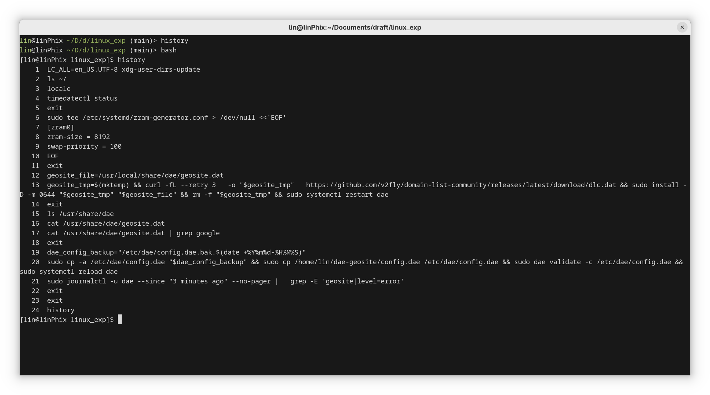

配置  

```sh
HISTSIZE=1000
HISTCONTROL=ignoredups
```

设置内存中保存的历史条目数量, 同时忽略与上一条相同的命令  

可见在设置上述变量之后, 输入两次的 `pwd` 只记录了一次, 与之前的 `exit` 形成对比  

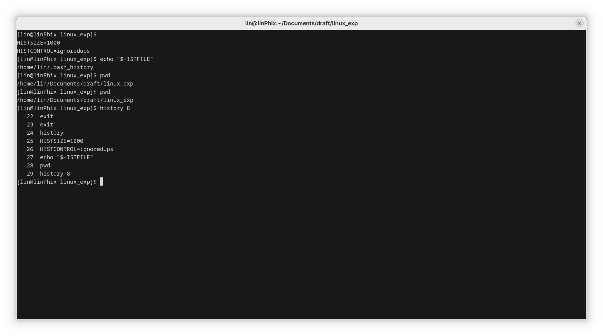

### 体会 bash 的命令补全功能

输入 `hist`, 按下 `<Tab>`, 补全为 `history`  
输入 `bash ./exp-2-2.s`, 按下 `<Tab>`, 补全为 `bash ./exp-2-2.sh`  

  
  

如图, 在补全文件名的时候如果出现重复前缀的部分, 会输出以进行提醒, 这时候需要补全至前缀不冲突的部分, 再进行补全  

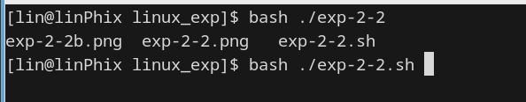

### 用 alias 定义别名, 然后执行

使用如下操作定义, 查看, 执行别名, 这里以 `ls -hl` 为例  

```sh
alias ll='ls -lh'
alias ll
ll
```

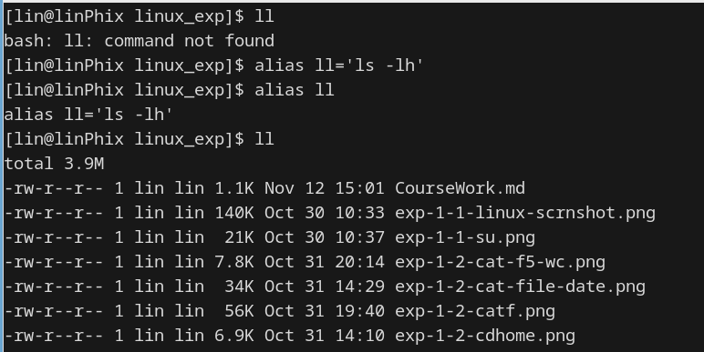

### 对下面的 shell 脚本进行编辑, 然后执行

原脚本  

```sh
count = $#
cmd = echo
while [ $count -gt 0 ]
do 
    cmd="$cmd \$$count"
    count=`expr $count-1`
done
eval $cmd
```

脚本给 `count` 和 `cmd` 赋值时，在等号两边加了空格，导致 Bash 把它们当成命令执行。`expr` 做减法时也缺少空格，`3-1` 会被当作一个字符串，导致下一轮循环无法进行整数比较。此外，拼接位置参数时应使用 `${10}` 这样的写法来处理两位数编号，并加上引号，避免参数里的空格或通配符被 Shell 误处理。

更改后  

```sh
count=$#
cmd=echo

while [ "$count" -gt 0 ]; do
    cmd="$cmd \"\${$count}\""
    count=$((count - 1))
done

eval "$cmd"
```

完美实现了其倒序输出参数的意图  

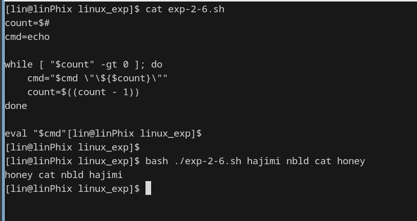

### 编写一个求斐波那契数列前 10 项以及总和的 shell 然后执行

shell 脚本如下  

```sh
#!/bin/bash
a=0
b=1
sum=0

for ((i = 0; i < 10; i++)); do
    printf '%s ' "$a"
    sum=$((sum + a))
    next=$((a + b))
    a=$b
    b=$next
done

printf '\nSum = %s\n' "$sum"
```

运行结果  

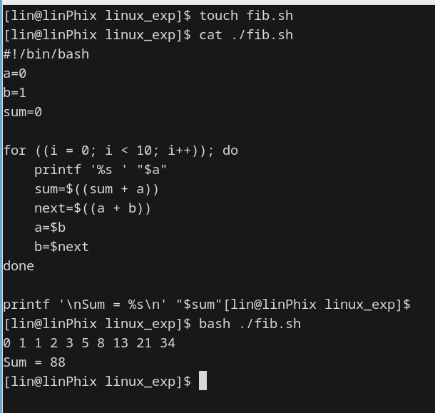

### 按照习题 4.18 的要求编写脚本, 然后执行

shell 脚本  

```sh
#!/bin/bash
IFS= read -r line
start=$(($1 - 1))
length=$(($2 - $1 + 1))
printf '%s\n' "${line:start:length}"
```

运行结果, 与课本要求一致  

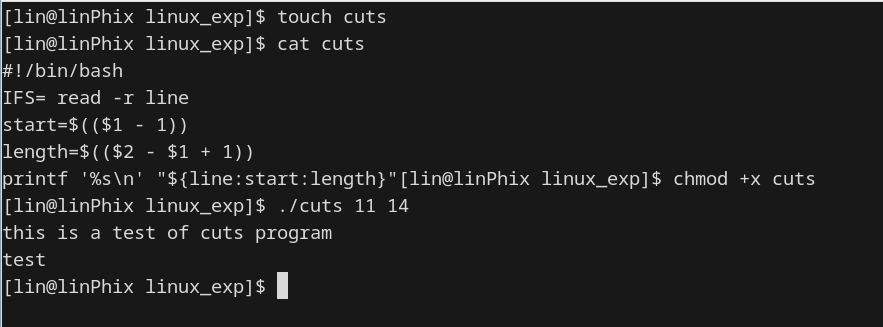

### 运行课本例 4.20 的程序. 若取消其中的 "eval", 则会出现什么情况? 

课本程序

```sh
#!/bin/bash
getc()
{
    stty raw
    tmp=`dd bs=1 count=1 2>/dev/null`
    eval $1='$tmp'
    stty cooked
}
press_any_key()
{
    echo -n "Strike any key to continue ..."
    getc anychar
}

echo -n "Enter a character: "
getc char
echo
echo "You entered $char "
press_any_key char
echo
```

运行结果  

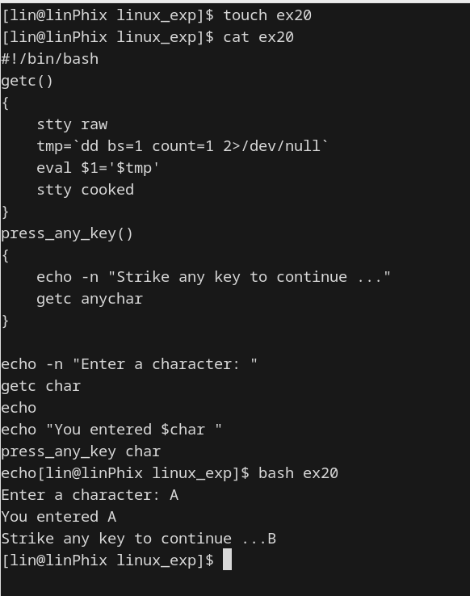  

若取消其中的 `eval`, 结果如下  

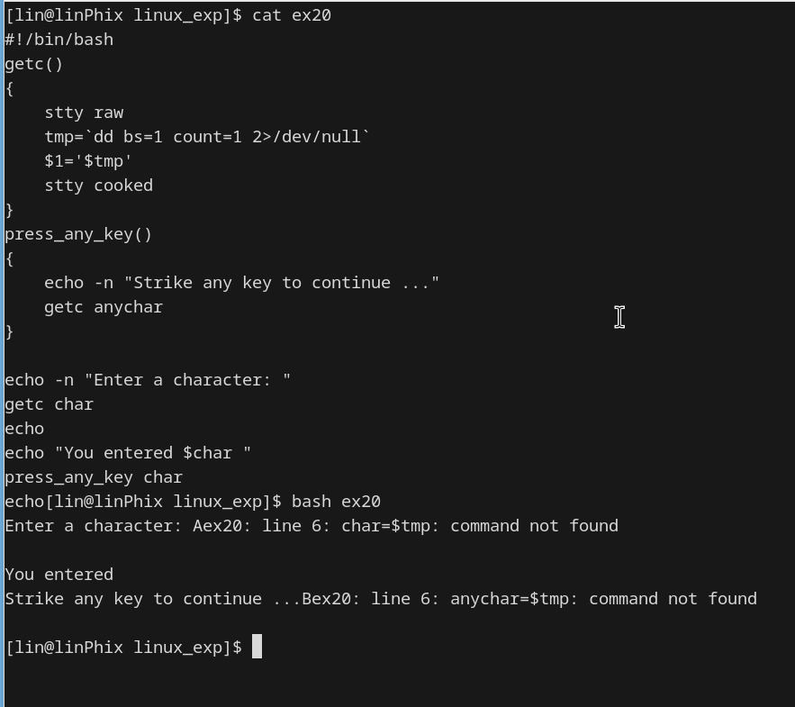

出现了诸如 `ex20: line 6: char=$tmp: command not found` 的提示  
这是因为有 `eval` 的时候, 第一次调用 `getc char` 会把读到的字符赋值给 `char`, 删除后会把 `char=$tmp` 当成命令名, 所以报错 `command not found`  
下方对 `anychar` 的操作同理   