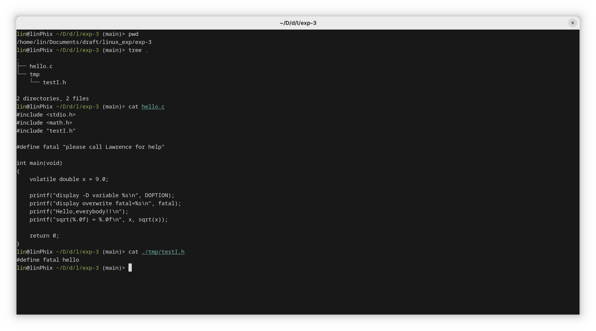
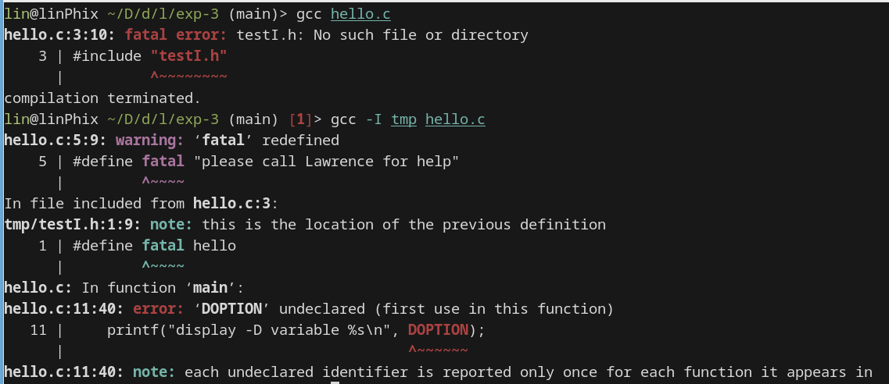
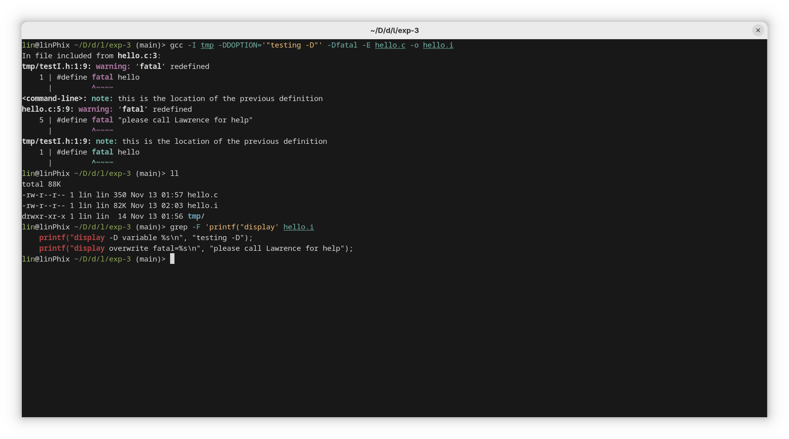
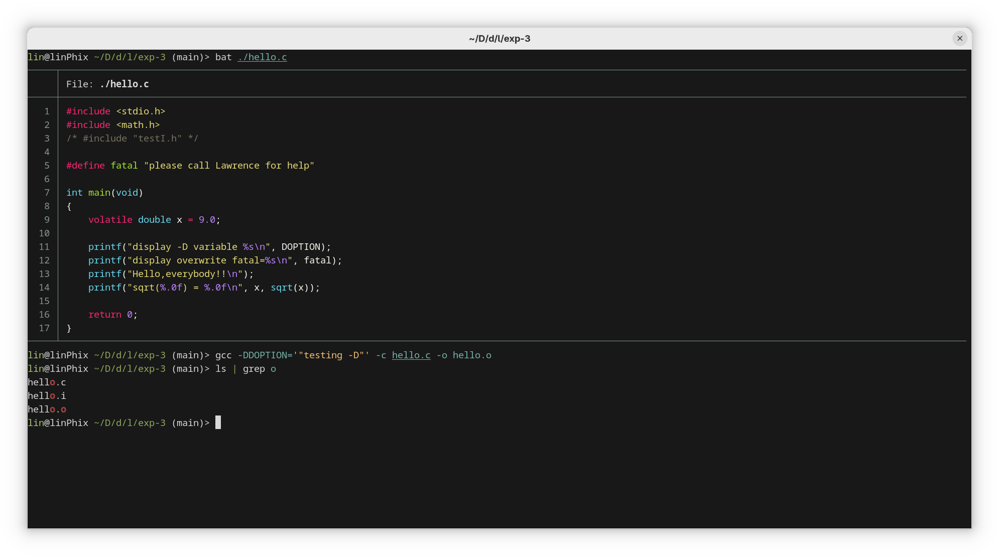
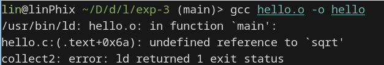
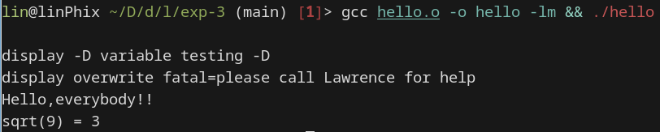

## 要求

### 目的

1. 掌握 C 语言编译系统 gcc 的基本用法

### 实验内容

1. 利用 gcc 命令编译 C 语言程序, 使用不同选项, 观察并分析显示结果

### 主要实验步骤

改写例 6.1, 使用下列选项对它进行编译: -I, -D, -E, -c, o, -l  

> # 【例 6.1】gcc 预处理选项的作用
> 
> ```console
> $ cat hello.c
> ```
> 
> ```c
> #include "testI.h"
> #define fatal "please call Lawrence for help"
> 
> main()
> {
>     /*testing CPP options */
>     printf("display -D variable %s\n",DOPTION);
>     printf("display overwrite fatal=%s\n",fatal);
>     printf("Hello,everybody!!\n");
> }
> ```
> 
> 直接用 `gcc` 编译 `hello.c` 文件，结果出现错误。
> 
> ```console
> $ gcc hello.c
> hello.c:1:19: 致命错误: testI.h: 没有那个文件或目录
>  #include "testI.h"
>                   ^
> 编译中断。
> $
> ```
> 
> 说明在当前目录 `/home/mengqc` 中没有 `testI.h` 文件。实际上，该文件在 `/home/mengqc/tmp` 中，并且其中有 `fatal` 的宏定义：`hello`。利用 `-I` 选项指定搜索该头文件的路径。
> 
> ```console
> $ gcc -I tmp hello.c
> hello.c:2:0: 警告: “fatal” 重定义 [默认启用]
>  #define fatal "please call Lawrence for help"
>  ^
> In file included from hello.c:1:0:
> tmp/testI.h:1:0: 附注: 这是先前定义的位置
>  #define fatal hello
>  ^
> hello.c: 在函数‘main’中:
> hello.c:7:2: 警告: 隐式声明与内建函数‘printf’不兼容 [默认启用]
>   printf("display -D variable %s\n",DOPTION);
>   ^
> hello.c:7:36: 错误: ‘DOPTION’未声明(在此函数内第一次使用)
>   printf("display -D variable %s\n",DOPTION);
>                                    ^
> hello.c:7:36: 附注: 每个未声明的标识符在其出现的函数内只报告一次
> ```
> 
> 说明 `fatal` 被重复定义，而 `DOPTION` 未被声明。
> 
> ```console
> $ gcc -I tmp -D DOPTION='"testing -D "' -D fatal -E hello.c
> # 1 "hello.c"
> # 1 "<built-in>"
> # 1 "<命令行>"
> # 1 "/usr/include/stdc-predef.h" 1 3 4
> # 1 "<命令行>" 2
> # 1 "hello.c"
> # 1 "tmp/testI.h" 1
> In file included from hello.c:1:0:
> tmp/testI.h:1:0: 警告: “fatal” 重定义 [默认启用]
>  #define fatal hello
>  ^
> <命令行>:0:0: 附注: 这是先前定义的位置
> # 2 "hello.c" 2
> hello.c:2:0: 警告: “fatal” 重定义 [默认启用]
>  #define fatal "please call Lawrence for help"
>  ^
> In file included from hello.c:1:0:
> tmp/testI.h:1:0: 附注: 这是先前定义的位置
>  #define fatal hello
>  ^
> 
> 
> main()
> {
>     printf("display -D variable %s\n","testing -D ");
>     printf("display overwrite fatal=%s\n","please call Lawrence for help");
>     printf("Hello, everybody!!\n");
> }
> ```
> 
> 重新编辑 `hello.c` 文件，用注释符括起文件包含行（即 `/*#include "testI.h"*/`）。
> 
> ```console
> $ gcc -D DOPTION='"testing -D"' hello.c
> hello.c: 在函数‘main’中:
> hello.c:7:2: 警告: 隐式声明与内建函数‘printf’不兼容 [默认启用]
>   printf("display -D variable %s\n",DOPTION);
>   ^
> ```
> 
> 虽有警告，但仍生成可执行文件 `a.out`。运行 `a.out`，结果如下：
> 
> ```console
> $ a.out
> display -D variable testing -D
> display overwrite fatal=please call Lawrence for help
> Hello, everybody!!
> ```
> 

## 实验

### 准备部分

准备好 `exp-3/tmp/` 文件夹, 以及 `testI.h`, 以及使用更加现代化的 C 标准的 `hello.c` 文件  

在 `exp-3/tmp/testI.h` 中写入  

```h
#define fatal hello
```

在 `exp-3/hello.c` 中写入  

```c
#include <stdio.h>
#include <math.h>
#include "testI.h"

#define fatal "please call Lawrence for help"

int main(void)
{
    volatile double x = 9.0;

    printf("display -D variable %s\n", DOPTION);
    printf("display overwrite fatal=%s\n", fatal);
    printf("Hello,everybody!!\n");
    printf("sqrt(%.0f) = %.0f\n", x, sqrt(x));

    return 0;
}
```

使用 `volatile` 保留对变量 `x` 的访问, 避免编译器优化掉 `sqrt` 函数的调用  

下文所有操作在 `exp-3/` 目录中执行  



### 使用 `-I` 指定头文件搜索目录

运行  

```sh
gcc hello.c
gcc -I tmp hello.c
```



第一条命令看不到 `testI.h`, 第二条命令找到了 `testI.h`, 警告 `fatal` 重定义以及为定义 `DOPTION`  

### 使用 `-D` 定义宏, 使用 `-E` 查看预处理结果  

运行  

```sh
gcc -I tmp -DDOPTION='"testing -D"' -Dfatal -E hello.c -o hello.i
```

预处理之后的文件很多内容, 使用 `grep` 搜索想看的  

```sh
grep -F 'printf("display' hello.i
```



可见使用 `-D` 成功在命令行处定义了宏 `DOPTION`, 且 `-E` 展示了预处理结果  
在预处理结果中, `DOPTION` 被展开为我们传入的 `testing -D` 字符串, `fatal` 被展开为 `hello.c` 顶部定义的 `please ...` 字符串  

### 使用 `-c` 生成目标文件  

类似例 6.1, 注释 `#include "testI.h"`, 然后执行  

```sh
gcc -DDOPTION='"testing -D"' -c hello.c -o hello.o
```

已经生成目标文件 `hello.o`  



### 使用 `-l` 选项链接库, 使用 `-o` 命名输出的可执行文件  

运行  

```sh
gcc hello.o -o hello
```



可以看到, 显示 `sqrt` 未定义引用, 可以使用 `-lm` 来链接数学库 `libm`, 使用 `-o hello` 将可执行文件命名为 `hello`  

```sh
gcc hello.o -o hello -lm && ./hello
```



成功运行  