## 实验一 Linux 系统安装与简单配置

在实体机上安装了 Linux, Arch Linux 系统  

1. 跳过, VMwareWorkstation Pro 现在是免费使用的软件, 由于装有 Windows 系统的机器没有硬盘空间了, 决定跳过  
2. 安装了别的发行版
3. 在安装的时候, 进入 `arch-chroot` 之后, 使用 `passwd` 设置 `root` 用户的密码  
4. 使用 `su` 切换 `root` 用户, 使用 `su <username>` 切换其它用户  
    
5. 使用 `Ctrl + Alt + Fx` 来切换 tty, 例如令 Fx = F3 切换到 tty3
6. 使用 `poweroff` 或者 `shutdown -h now` 关机, 开机之后输入账户密码进行登录, 使用登录管理器进行登录并进入到图形界面, 或者直接在没有登录管理器的 tty 直接输入账户密码进行登录  
7. 配置登录管理器使得可以直接在登录后进入图形界面, 或登录未配置的 tty 手动输入 `niri` 命令打开我选择的 Windows Manager 提供的图形界面  
8. 使用 `reboot` 进行系统重启  

## 实验二 常用命令

1. 已完成
2. 如图, 已经会基本使用, 由于 `clear` 会清理缓冲区, 不能截图显示效果  
    
3. 如图
      
      
    

-----------  

呃, 上面的是根据实验目的自己做的步骤, 接下来再根据主要实验步骤再做一次  

1. 使用 `passwd` 修改当前用户密码  
2. 参上  
    
3. `pwd` 查看当前工作目录; `ls` 查看当前目录内容, `-i` 显示每个文件的 inode 编号, `-a` 显示所有文件 (.开头的文件默认隐藏), `-l` 以列表形式显示文件; 使用 `cd /` 来到根目录  
    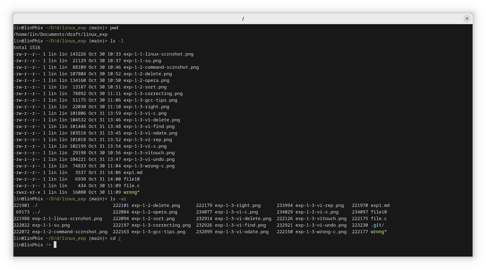  
   使用 `cd` 默认回到家目录, 通常是 `/home/<username>/`  
    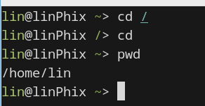  
   创建了 subdir 并将工作目录改到 subdir, 同时使用 `pwd` 验证了当前工作目录确实是 subdir  
    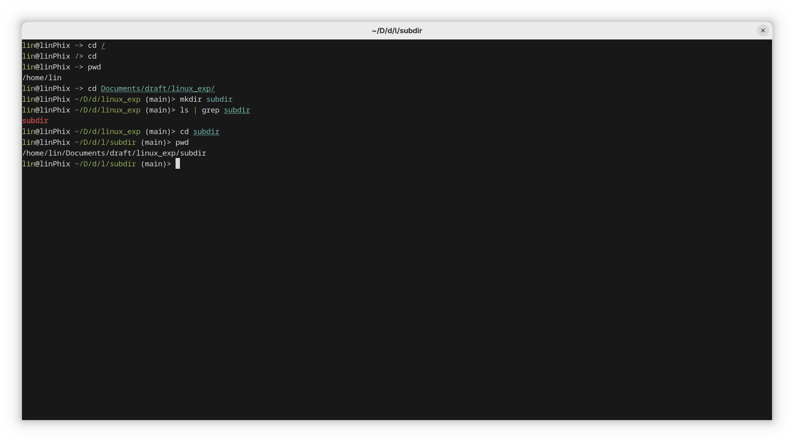  
4. 文件操作  
    1. 见上
    2. 看到了 `date` 的结果存放在了 `file1` 里面  
        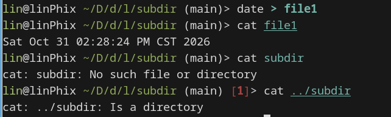  
    3. 首先当前目录没有名为 `subdir` 的文件名或目录名, 其次 `../subdir` 是一个目录, 不能被 `cat` (将文件内容输出到 stdout), 图片见上  
    4. 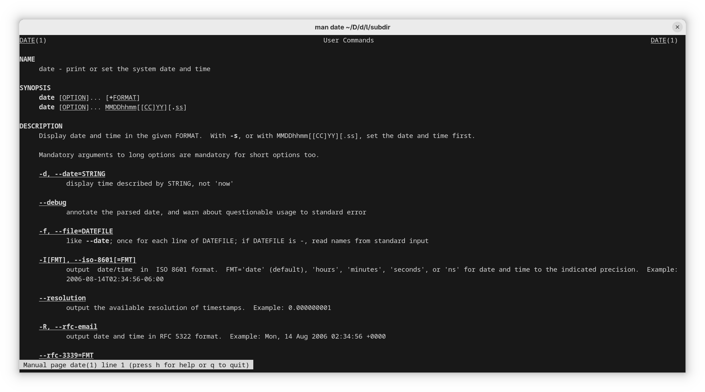  
    5. 看不到, 因为输出被重定向至文件流了, 然后 `cat` 之后显示的是原来 `date` 的内容和后续增加的 `man date` 的内容  
       `>` 会覆盖原文件, `>>` 会附加到原文件末尾  
        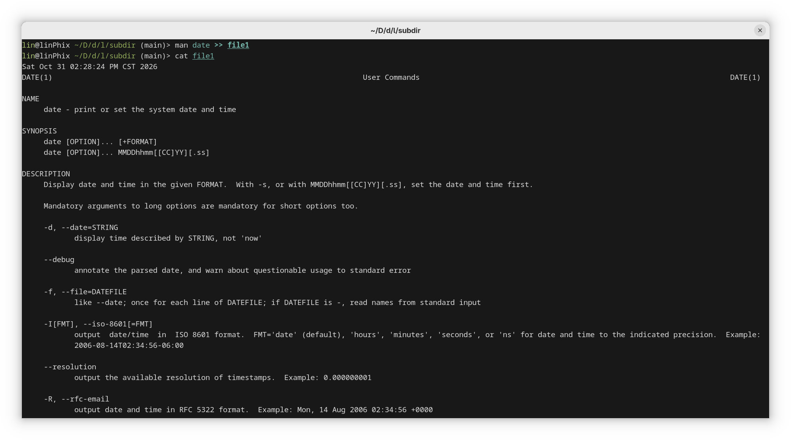  
    6. 链接计数在所有权一串字母后面, 一开始显示 1  
        使用 `ln` 创建硬链接, 链接计数加一, 变成 2  
        `cat ../fa` 输出与 file1 相同的内容  
        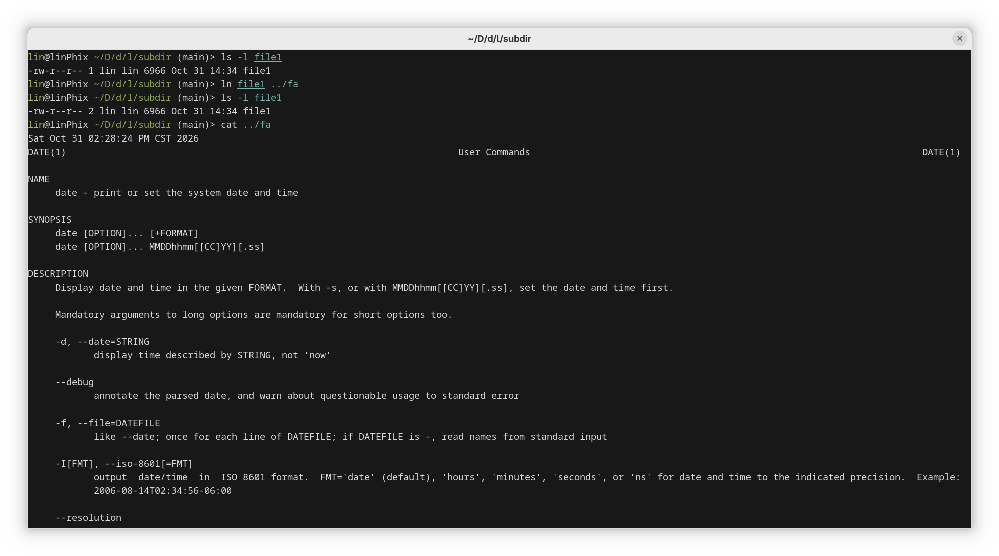  
    7. 使用 `head` 和 `tail` 显示文件的前后十行  
        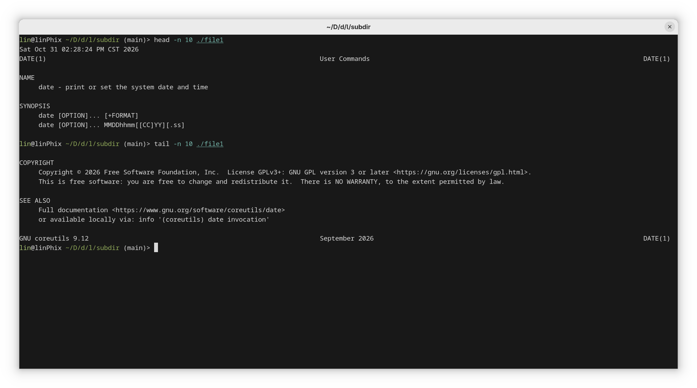    
    8. 运行 `cp file1 file2` 发现当前目录存在两个文件 `file1` 和 `file2`  
        运行 `mv file2 file3` 发现当前目录存在两个文件 `file1` 和 `file3`  
        这表明使用 `cp` 命令来复制文件并制定新文件名字, 使用 `mv` 命令可以移动文件并指定新文件名字, 也常用于重命名  
        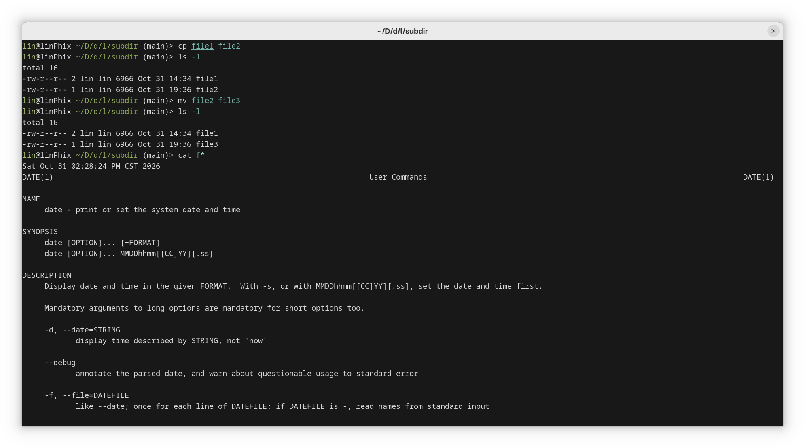    
        运行 `cat f*` 将目录下符合 `f*` 模式的文件 `file1` 和 `file3` 都输出了, 可见明显分界线
        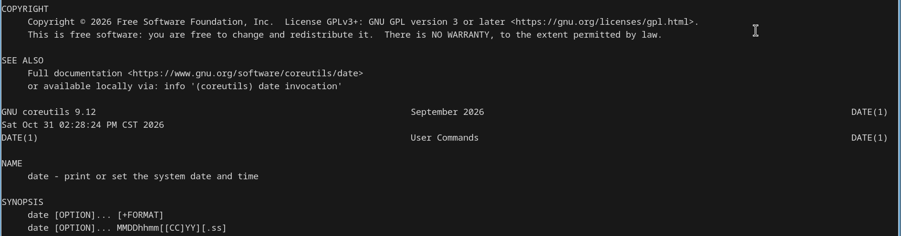  
    9. 发现只剩下 `file1` 了, `rm` 命令用来删除 (remove) 文件  
        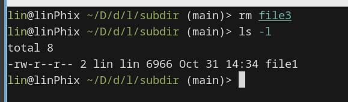  
    10. 倒数第四行  
        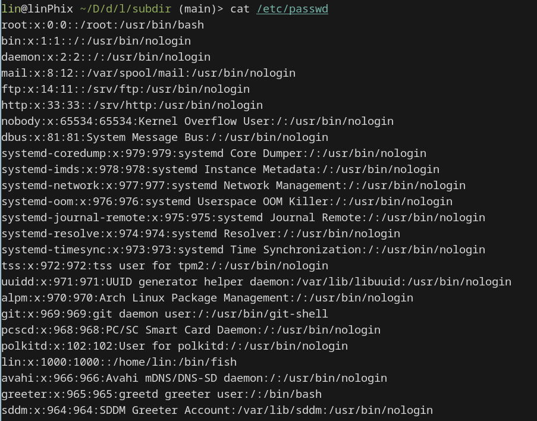  
    11. `ls -l` 之后第一列那一串字母就是文件的权限  
        含义如下  
            - 第一位, `-` 表示普通文件, `d` 表示目录, `l` 表示符号链接
            - 2 到 4 位, `rwx`, 没有的权限会用 `-` 代替, 代表文件所有者的读写运行权限 
            - 5 到 7 位, `rwx`, 没有的权限会用 `-` 代替, 代表文件所属组的其他成员的读写运行权限
            - 8 到 10 位, 描述同上, 其他用户的权限
        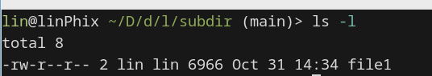  
    12. 可以使用 `chmod` 的字母和数字两种方式, 字母好理解, rwx 就是相当于把这个看成一个三位二进制数, 有权限的是 1, 没有的是 0  
        例如 `chmod +x ./test.py` 给 test.py 的当前用户**加上**可执行权限; `chmod u=rw ./test.py` 又把当前用户的权限改回 `rw`   
        而数字方式 `chmod 777 ./test.py` 表示给三个权限组都加上完整的 rwx 权限, 因为 `7 = 0b111`  
        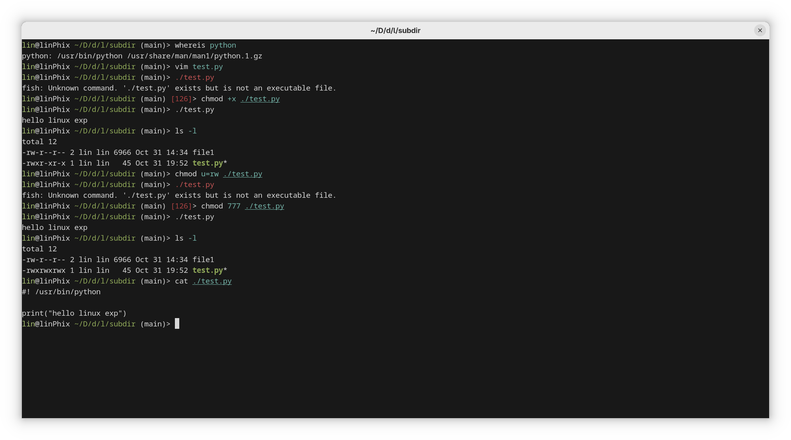  
    13. 使用 `wc -l file1` 统计行数, 使用 `wc -w file1` 统计词数  
        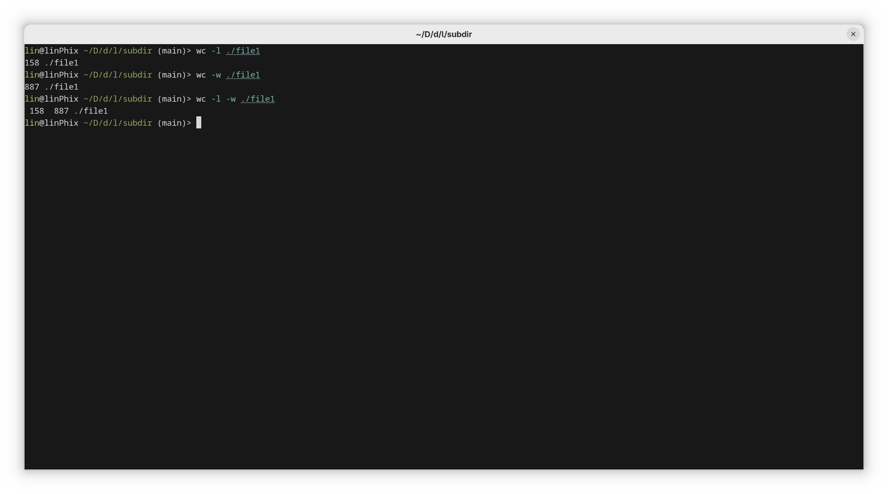
    14. 使用 `man ls | more` 的意思是将 `man` 的输出管道给 `more` 的输入, `more` 是一个只能向下滚动的方便阅读的软件, 方便不让内容一下子铺满终端, 特别对于在使用 tty 的人非常方便, 因为那里不能滚动; 另外 `less` 也是一个很好的选择, 同时还提供了向上滚动的功能, 可以重新看不小心滚过的地方; 另外我的 `man` 似乎本来就带有类似 `less` 的功能; 它们都可以使用 `q` 退出    
        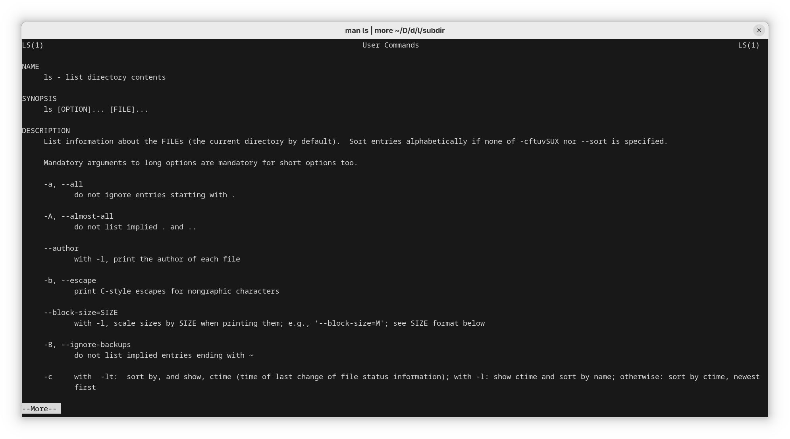  
        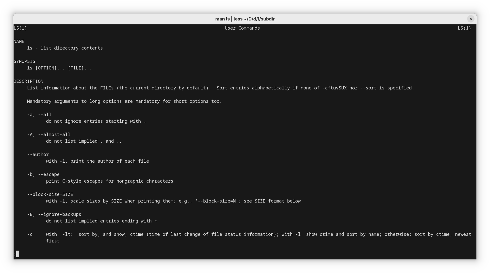  
        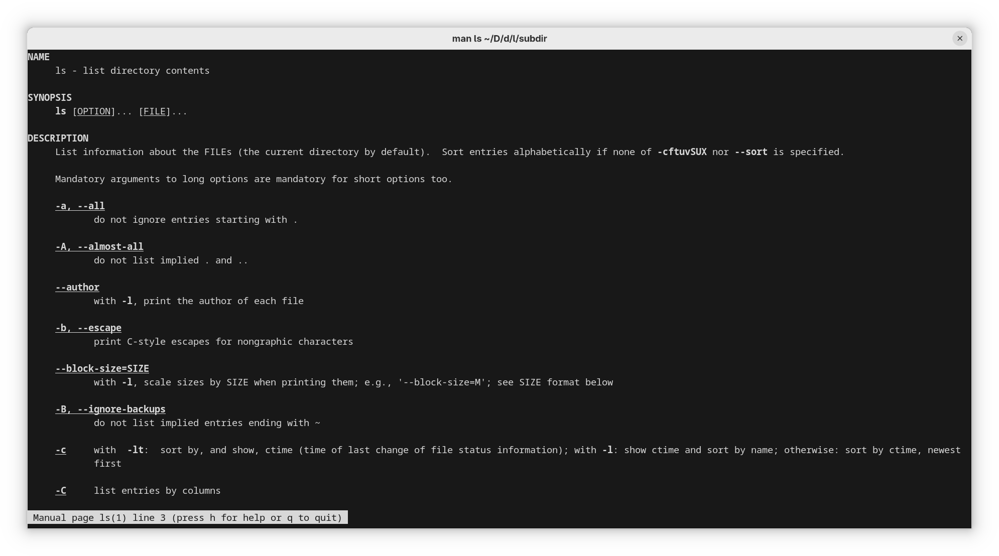  
        运行 `cat file1 | haed -20 | tee file5`, 效果如下, 作用大概是取 file1 的头 20 行创建 file5   
        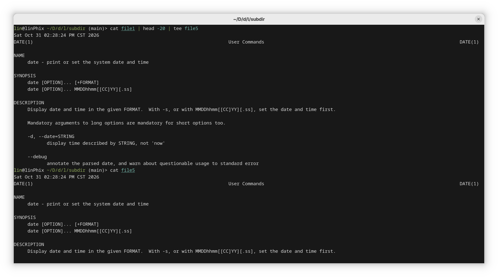  
        `cat file5 | wc` 的运行结果如下, 输出了 `file5` 的行数, 单词数和字节数  
        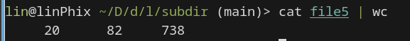  

## 实验三 vi编辑器  

1. 输入 `vi` 进入 `vi`
2. 使用 `vi file.c` 编辑名为 `file.c` 的文件, 在 Normal 模式下使用 `:w` 进行文件的写, 即创建一个空文件  
      
   在 Normal 模式下输入 `i` 在当前光标位置进入 Insert 模式, 输入一个有错误的 C 语言程序  
      
   使用 `Esc` 返回 Normal 模式, 使用 `:wq` 保存文件并退出, 使用 `gcc ./file.c -o ./wrong` 进行编译  
      
   可见 `gcc` 给出了非常详细的错误提示以及常见错误的改正意见, 其中推荐 `#include <stdint.h>` 来引入符号 `int64_t`, 并且将不存在的函数 `print` 改为 `stdio.h` 中的 `printf`  
   改正后  
    
   可见其按照期望运行   
      
3. 使用 `man date > file10` 并使用 `vi` 打开  
    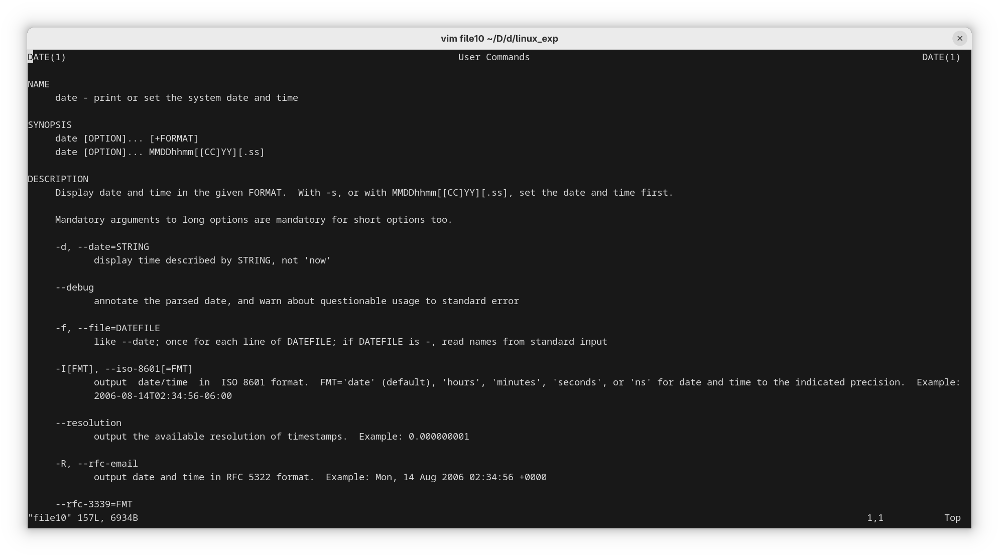
   在 Normal 模式下使用 `x` 可以当前光标字符, 此处连续删除了 `Display`, `dd` 可以删去一行, 此处删去了 `Display` 的下一行    
    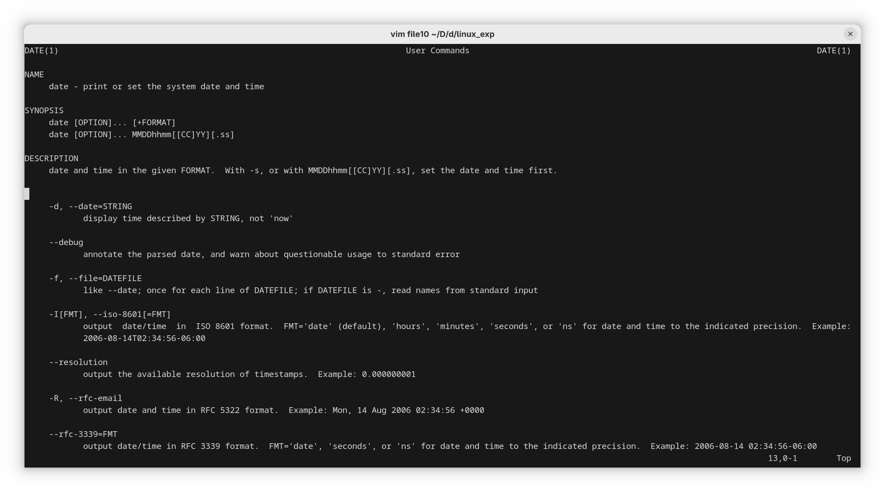  
   使用 `u` 进行了复原, 可以查看左下角作证  
    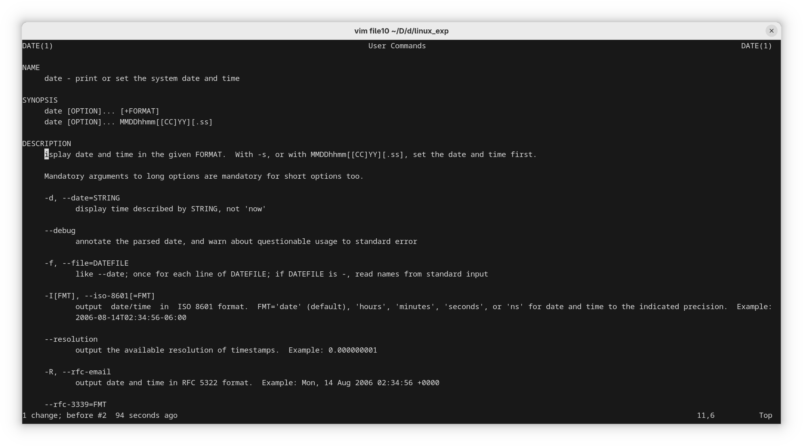
   使用 `/<word>` 进行检索, 此处检索了 `date` 单词  
    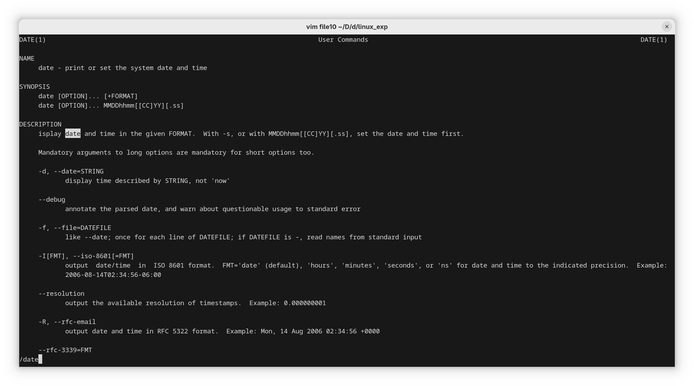
   `r<char>` 将当前字符替换成 `<char>` 此处把 `i` 替换成了 `a`  
    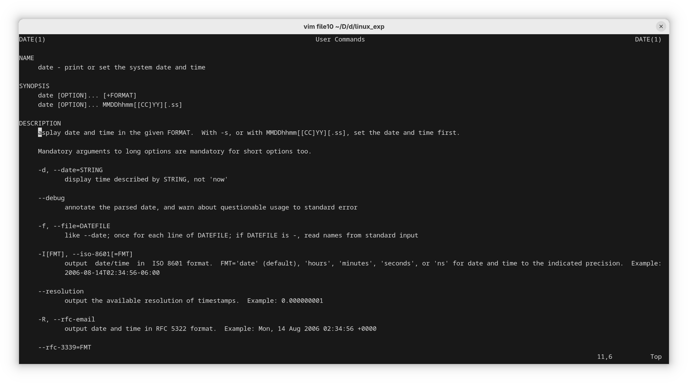
   `s` 将当前字符删去并进入 Insert 模式, 此处删去了刚才替换的 `a` 并在 Insert 模式下输入了 `hello `  
    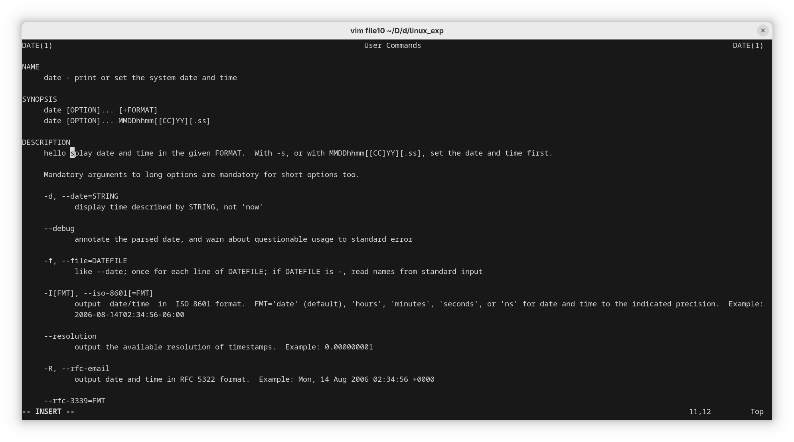
   `c` 将当前范围删去并进入 Insert 模式, 此处删去了 `splay` 并在 Insert 模式下输入了 `treap`  
    
4. 使用 `<Esc>` 退出 Insert 模式, 使用 `:wq` 保存文件并退出编辑  