## 实验一 Linux 系统安装与简单配置

在实体机上安装了 Linux, Arch Linux 系统  

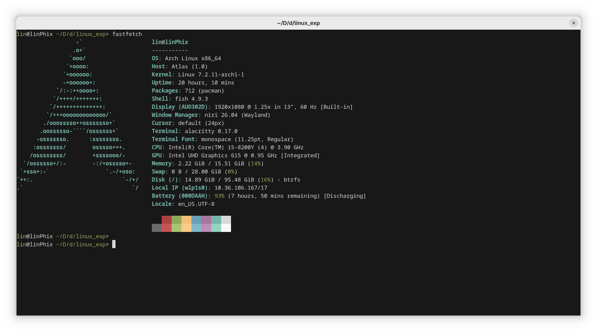

1. 跳过, VMwareWorkstation Pro 现在是免费使用的软件, 由于装有 Windows 系统的机器没有硬盘空间了, 决定跳过  
2. 安装了别的发行版
3. 在安装的时候, 进入 `arch-chroot` 之后, 使用 `passwd` 设置 `root` 用户的密码  
4. 使用 `su` 切换 `root` 用户, 使用 `su <username>` 切换其它用户  
    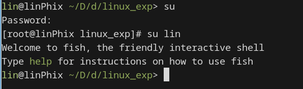
5. 使用 `Ctrl + Alt + Fx` 来切换 tty, 例如令 Fx = F3 切换到 tty3
6. 使用 `poweroff` 或者 `shutdown -h now` 关机, 开机之后输入账户密码进行登录, 使用登录管理器进行登录并进入到图形界面, 或者直接在没有登录管理器的 tty 直接输入账户密码进行登录  
7. 配置登录管理器使得可以直接在登录后进入图形界面, 或登录未配置的 tty 手动输入 `niri` 命令打开我选择的 Windows Manager 提供的图形界面  
8. 使用 `reboot` 进行系统重启  

## 实验二 常用命令

1. 已完成
2. 如图, 已经会基本使用, 由于 `clear` 会清理缓冲区, 不能截图显示效果  
    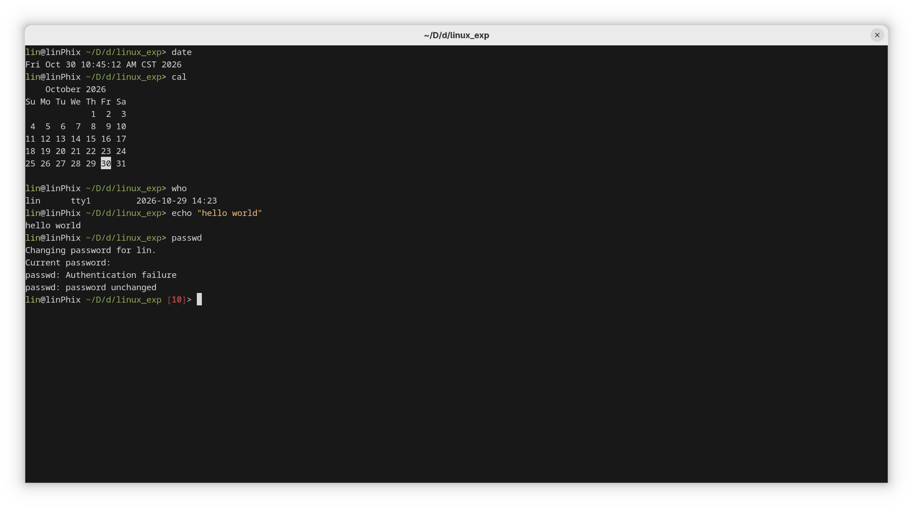
3. 如图
    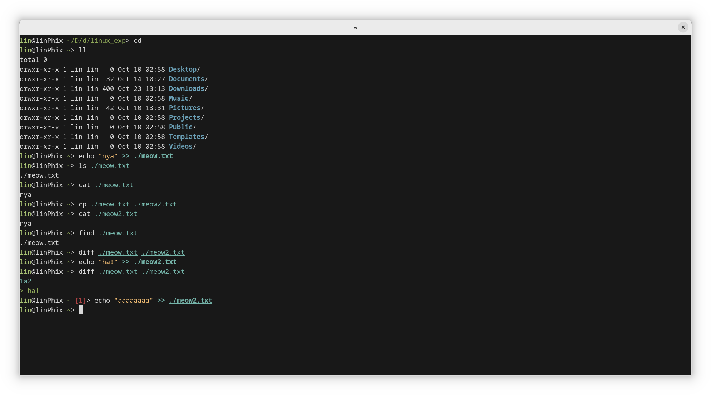  
    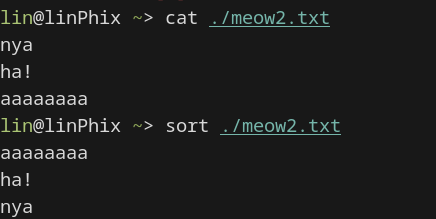  
    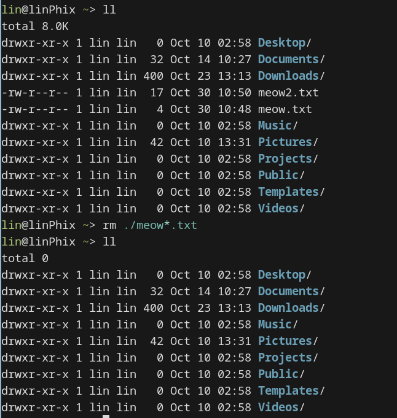
4. 

## 实验三 vi编辑器  

1. 输入 `vi` 进入 `vi`
2. 使用 `vi file.c` 编辑名为 `file.c` 的文件, 在 Normal 模式下使用 `:w` 进行文件的写, 即创建一个空文件  
    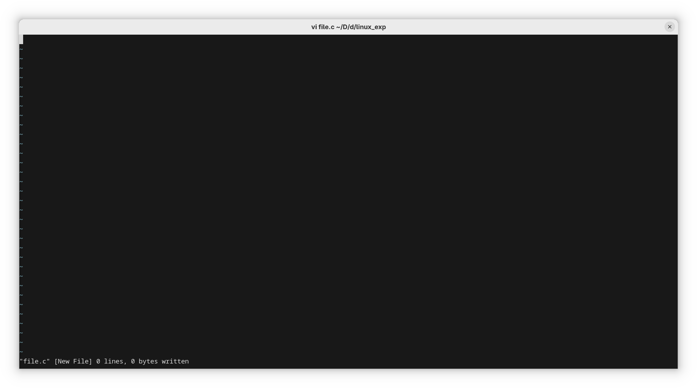  
   在 Normal 模式下输入 `i` 在当前光标位置进入 Insert 模式, 输入一个有错误的 C 语言程序  
    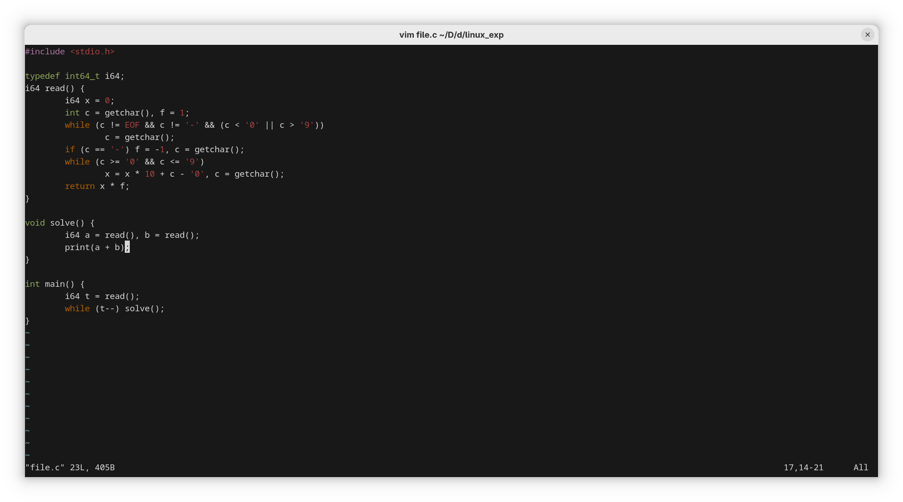  
   使用 `Esc` 返回 Normal 模式, 使用 `:wq` 保存文件并退出, 使用 `gcc ./file.c -o ./wrong` 进行编译  
    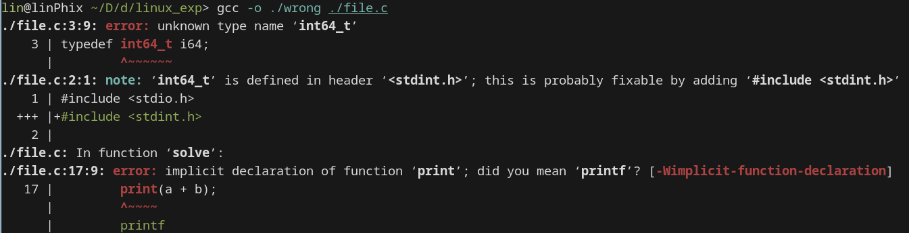  
   可见 `gcc` 给出了非常详细的错误提示以及常见错误的改正意见, 其中推荐 `#include <stdint.h>` 来引入符号 `int64_t`, 并且将不存在的函数 `print` 改为 `stdio.h` 中的 `printf`  
   改正后  
    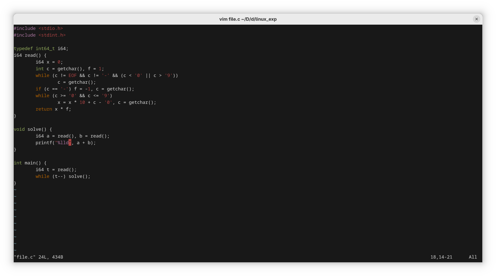
   可见其按照期望运行   
    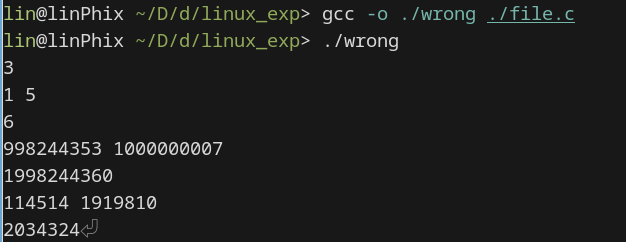  
3. 